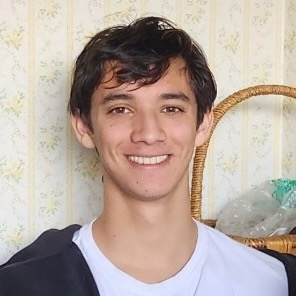

I'm a PhD student at **UC San Diego (Halıcıoğlu Data Science Institute)**, where I am grateful to be advised by Yu-Xiang Wang. I work on **statistical learning theory** and **adaptive algorithms** for real-world data, with interests in **reinforcement learning**, **non-parametric statistics**, **online learning**, and lately **diffusion models**.

- 📬 Email: <smadhow@ucsd.edu>
- 🔗 Links: [Google Scholar](#), [GitHub](https://github.com/SunilMadhow), [LinkedIn](https://www.linkedin.com/in/sunil-madhow)
- 🧪 Research areas: offline RL, non-parametric regression, online learning
